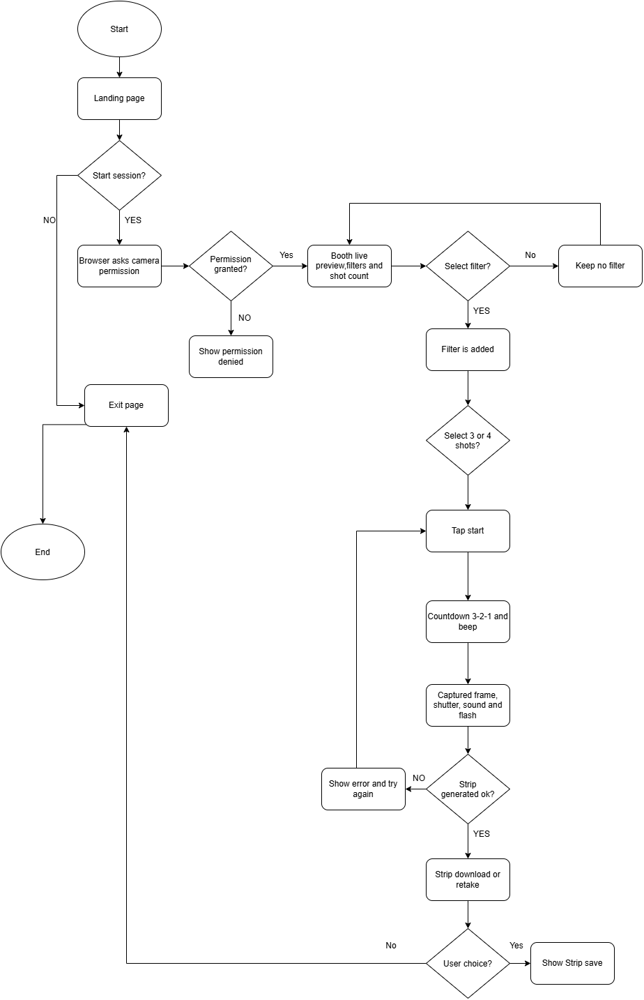
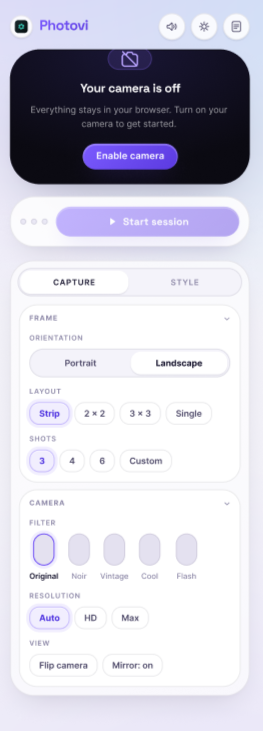
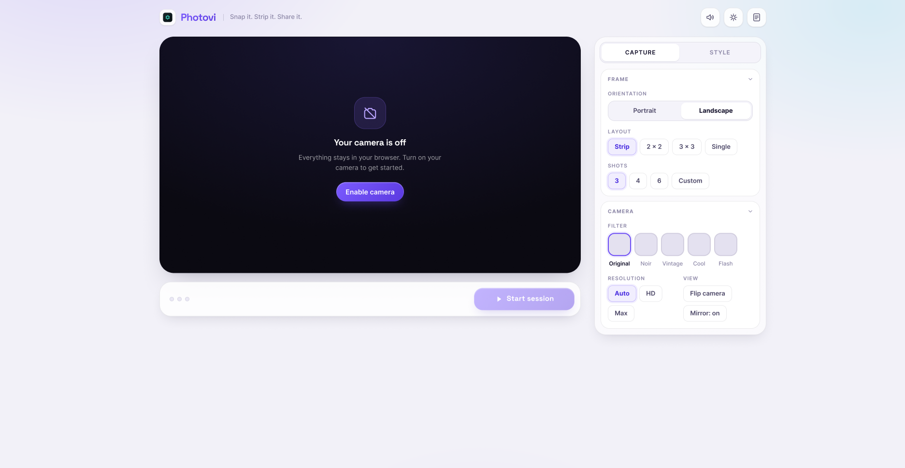

# PHOTOVI

## Design Process Portfolio

**Subject:** Interactive Media Development

**Group:** Fantastic4

**Members:**
- Lawrence Brian Dejan
- Neoh Del Prado
- Juliamay Nina Estrada
- Kyle Tristan Turno

| Date | Version | Description | Author |
|------|---------|-------------|--------|
| 10/05//2026 | 1.0 | Design Process Portfolio | Fantastic4 |

---

## 1. Project Summary

| Field | Details |
|-------|---------|
| Project title | PHOTOVI |
| Group | Fantastic4 |
| Members | Lawrence Brian Dejan, Neoh Del Prado, Juliamay Nina Estrada, Kyle Tristan Turno |
| Submitted by | |
| Submission date | [MM/DD/2026] |
| Concept statement | PHOTOVI is a browser-based digital photo booth that lets anyone preview filters live, take a countdown-timed series of photos, and download a printed-style photo strip with no install, login, or upload. |
| Primary audience | [CONFIRM against Part 1] Students and young adults using a phone or laptop who want a quick, playful photo-booth experience. |
| Primary user goal | Create a styled photo strip and save it to their device in one short session. |

**Summary from the approved Part 1 direction**

1. PHOTOVI recreates the mall or event photo booth in the browser, with no installation and no account.
2. Built with only HTML5, CSS3, and vanilla JavaScript, using the browser's camera (getUserMedia), Canvas, and Web Audio APIs.
3. No database and no server. Photos are processed locally and never uploaded.
4. Core scope: live preview, real-time filters, shot-count choice (3 or 4), countdown with sound, vertical photo strip with date stamp, single-image download.
5. Required error handling: camera permission denied and filter failure (SRS 3.1.8, 3.1.9).

---

## 2. Content Inventory and Information Structure

### 2.1 PHOTOVI Content Inventory

| ID | Content item | Purpose | Location | Format | Source / owner | Status |
|----|--------------|---------|----------|--------|----------------|--------|
| C01 | PHOTOVI logo / wordmark | Brand identity | Header, all screens | SVG | Original (group) | ready |
| C02 | Intro headline and short description | Explain what the site does | Landing | Text | Group | drafting |
| C03 | Start Camera button | Primary action; triggers permission request | Landing | Button | Group | ready |
| C04 | Privacy note: "Your photos stay on your device" | SRS 3.12 | Landing, footer | Text | Group | drafting |
| C05 | Live camera preview | Main focus of the booth | Booth | video / Canvas | Device camera | ready |
| C06 | Filter thumbnails | Real-time filter choice (3.1.2) | Booth, below preview | PNG thumbnails | Original (group) | ready |
| C07 | Shot-count selector | Strip size (3.1.3) | Booth | Toggle buttons | Group | ready |
| C08 | Step instructions (Filter, Shots, Start) | On-screen help (3.8) | Booth | Text | Group | planned |
| C09 | Start button | Begin session | Booth | Button | Group | ready |
| C10 | Countdown numerals (3-2-1) | Visual capture cue (3.1.4) | Capture overlay | CSS / text | Original | ready |
| C11 | Shot progress ("Photo 2 of 4") | Status feedback | Capture | Text | Group | ready |
| C12 | Countdown beep | Audio cue | Capture | WAV (Web Audio) | Original (synth or recorded) | ready |
| C13 | Shutter sound | Capture feedback (3.1.5) | Capture | WAV / MP3 | Original | planned |
| C14 | Flash animation | Visual capture feedback | Capture overlay | CSS animation | Original | planned |
| C15 | Cancel button | Exit mid-session | Capture | Button | Group | ready |
| C16 | Photo strip with border and other design | Final output (3.1.6) | Results | Canvas to PNG | Generated at runtime | ready |
| C17 | Download button | Primary action (3.1.7) | Results | Button | Group | ready |
| C18 | Retake button | Secondary action | Results | Button | Group | ready |
| C19 | "Strip saved" confirmation | Success feedback | Results | Text / toast | Group | ready |
| C20 | Permission-denied message and steps | Error recovery (3.1.8) | Error screen | Text + icon | Group | ready |
| C21 | No camera / unsupported browser message | Error recovery | Error screen | Text + icon | Group | planned |
| C22 | Filter-failed message | Error recovery (3.1.9) | Toast on Booth | Text | Group | planned |
| C23 | Strip-generation failed message + Try again | Error recovery | Results | Text | Group | planned |
| C24 | Student-project notice, credits, attributions | SRS 3.12 | Footer | Text | Group | planned |
| C25 | Mute / sound indicator | Audio state feedback | Booth, Capture | SVG icon | Original | planned |

### 2.2 Information Structure

PHOTOVI is a single-page, state-based app. The task is linear, so the user never needs to navigate between pages. Each state shows one primary action.

| Level | Screen / state | Contains |
|-------|----------------|----------|
| 1 | Landing | C01, C02, C03, C04, C24 |
| 2 | Booth | C05 to C09, C22, C25 |
| 3 | Capture | C10 to C15 |
| 4 | Results | C16 to C19, C23 |
| Additional | Error states | C20, C21 |

Screen order: Landing, then Booth, then Capture and Results. Retake returns to Booth and Cancel returns to Booth. Error states return to Landing through Try again or Retry.

Users are casual, often on phones, and want a quick result. The SRS requires that a first-time user complete a session without a tutorial (3.2.2). A linear flow with one dominant action per screen, and instructions placed where the action happens, supports that. Privacy and project notices stay in the footer so they are available but do not compete with the task.

---

## 3. Primary User Flow

### 3.1 Flow Diagram

*Diagram flow (text version of the image above):*
Start → Landing page → "Start session?" (NO → Exit page → End; YES → Browser asks camera permission) → "Permission granted?" (NO → Show permission denied; Yes → Booth live preview, filters and shot count) → "Select filter?" (No → Keep no filter, back to Booth live preview; YES → Filter is added) → "Select 3 or 4 shots?" → Tap start → Countdown 3-2-1 and beep → Captured frame, shutter, sound and flash → "Strip generated ok?" (NO → Show error and try again, back to Tap start; YES → Strip download or retake) → "User choice?" (Yes → Show Strip save; No → Exit page).

### 3.2 Flow explanation

**Primary success path** - The user opens the site, taps Start Camera, and allows permission. They see a live preview, pick a filter and 3 or 4 shots, then tap Start. The countdown and capture repeat until all shots are taken. The strip is composed, the user taps Download, and the file is saved.

**Most important failure path** - Camera permission denied. Without the camera the product cannot work, so this is the highest-risk failure and is required by SRS 3.1.8.

**Recovery** - The error screen explains in plain language why the camera is needed and gives short steps to re-enable it in the browser. A Try again button re-requests access without reloading the page. Other recoveries: a failed filter falls back to the unfiltered feed and the session continues; Cancel returns to the Booth with no data kept; a failed strip or save offers Try again; repeat Start taps are ignored.

**SRS requirements represented in the flow:**

| Flow element | SRS requirement |
|--------------|-----------------|
| Permission request and live preview | 3.1.1, 3.5 |
| Filter selection and fallback | 3.1.2, 3.1.9 |
| Shot-count selection | 3.1.3 |
| Countdown loop with beep | 3.1.4 |
| Capture with shutter sound | 3.1.5 |
| Strip composition with date stamp | 3.1.6 |
| Download | 3.1.7 |
| Permission-denied recovery | 3.1.8, 3.3 |
| On-screen instructions | 3.8 |
| Privacy notice | 3.12 |

---

## 4. Wireframes

### Wireframes (Mobile layouts)

### Wireframes (Desktop layouts)

---

## 5. Visual and Interface Design Direction

### 5.1 Color palette

| Role | Name | Hex | Use |
|------|------|-----|-----|
| Background | Soft Lavender | #EEEBF8 | Main app background on all screens (the light gradient in the wireframes). |
| Surface | White Card | #FFFFFF | Panels, cards, and the session bar that hold the controls. |
| Camera panel | Deep Night | #0F0E1A | Live preview area, including the "Your camera is off" state. |
| Text | Ink Navy | #1F1F33 | Headings, button labels, and body text on light surfaces. |
| Text on dark | Pure White | #FFFFFF | Text on the camera panel and on primary buttons, plus the 3-2-1 countdown numerals. |
| Primary action | Photovi Purple | #6246EA | The one primary button per screen: Enable camera, Start session, Download, Try again. Also the wordmark. |
| Primary hover / pressed | Deep Purple | #5235D4 | Hover and pressed states of the primary button. |
| Primary disabled | Pale Purple | #B9A9F5 | Greyed-out primary button, such as "Start session" before the camera is on. |
| Selected / highlight | Soft Violet | #EDE8FF | Fill for the selected shot count, layout, and filter, with a Photovi Purple border. |
| Muted text | Slate Grey | #5F5F7A | Section labels, hints, filter names, and the privacy note. |
| Unselected control | Mist | #E4E2EF | Filter thumbnails and toggles that are not selected. |
| Error | Alert Red | #DC2626 | Error borders and error messages only, never a primary button. |
| Strip paper | Cream | #F5EFE0 | Border and background of the generated photo strip. |
| Strip ink | Strip Ink | #1A1A2E | Date stamp, thin rules, and text on the strip. |

### 5.2 Typography

| Use | Font | Size | Notes |
|-----|------|------|-------|
| Headings, buttons, countdown | Inter / Plus Jakarta Sans | 16px – 20px (Bold) | Easy to read headers and key actions |
| Body, instructions, messages | Inter / Plus Jakarta Sans | 12px 14px (Regular) | Help messages and small hints |
| Fallback | System UI | Standard | Default screen font |

*(In the original PDF, each of these three rows appears repeated three times across the table columns because of the table layout. The content is the same as shown above.)*

### 5.3 Spacing and layout rules

- 8 px spacing scale: 8, 16, 24, 32, 48.
- Content max width 1100 px on desktop. Single column below 768 px.
- One primary action per screen, always the largest element and the only red element.
- Touch targets at least 48 by 48 px with 8 px gaps.
- The live preview is the largest element on the Booth screen.

### 5.4 Button and control styles

| Control | Style |
|---------|-------|
| Primary (Start, Download, Try again) | Big, rounded red button with white text |
| Secondary (Retake, Cancel) | Dark box with a thin outline |
| Filter thumbnail | Small square preview box with a label below |
| Shot-count toggle | Small toggle boxes with clean borders |
| Focus ring | Thin purple line around selected items |

### 5.5 Component states

| Component | Default | Hover | Focus | Active / selected | Disabled | Error |
|-----------|---------|-------|-------|-------------------|----------|-------|
| Start button | Red | Dark Red | Pressed in | Pressed in | Greyed out | Red border outline |
| Filter thumbnail | Dark Square | Slighty Ligther | Bright purple border | Bright purple border | Faded | N/A |
| Shot-count toggle | Shot Toggle | Soft Background | Solid purple fill | Solid purple fill | Faded | N/A |
| Download button | Download button | Darker Red | Pressed in | Pressed in | Greyed out | Red border outline |

### 5.6 Image, illustration, and icon direction

1. Flat vector illustrations (photo strip, camera, sparkles) in the palette above, created by the group in Figma or Inkscape, exported as SVG.
2. Icons: simple outline style at 24 px drawn by the group.
3. Filter thumbnails use one consistent sample photo so users compare filters fairly.
4. The photo strip uses a cream border and thin Ink rules so it reads as a printed strip.

### 5.7 How the visual decisions support the project

| Goal | Supporting decisions |
|------|----------------------|
| Audience | Large touch targets, rounded friendly type, short instructions |
| Purpose | The preview dominates the screen; one red action per screen guides the user to the next step |
| Readability | Ink on cream at 15.91:1; 16 px minimum body text; 120 px countdown readable at arm's length |
| Hierarchy | Size and color separate primary from secondary actions |
| Interaction feedback | Defined hover, focus, selected, disabled, and error states; toast area for system messages; flash and shutter sound on capture |
| Accessibility | Contrast checked against WCAG; selection never relies on color alone; visible focus ring; reduced-motion alternative; visual countdown works without sound |
| Device and environment | Mobile-first stacked layout; high contrast works in bright indoor and outdoor light; horizontal filter scrolling avoids hiding the preview |

---

## 6. Media Asset Plan and Production Record

| ID | Asset and purpose | Source / creator | Editable source | Export | Size / duration | Accessibility alternative | Status |
|----|-------------------|------------------|-----------------|--------|-----------------|---------------------------|--------|
| AP01 | PHOTOVI logo (brand identity) | Original, group | logo.fig / .svg | SVG | 200x48 px, under 5 KB | Alt text: PHOTOVI logo | ready |
| AP02 | Landing illustration (photo strip) | Original | landing-illustration.fig | SVG | 320x320 viewBox, under 15 KB | Descriptive alt text, or decorative | ready |
| AP03 | Filter thumbnails | Original sample photo with filters | filters.psd / Figma | WebP or PNG | 72x72 px (144 px at 2x), each under 10 KB | Label with filter name | ready |
| AP04 | Icon set (mute, lock, warning) | [Original or open license: record source and license] | .svg | Inline SVG | 24x24 px | aria-label on each | ready |
| AP05 | Countdown beep | Original, synthesized or recorded | beep.aup3 (Audacity) | WAV or MP3 | About 0.2 s, under 20 KB | Visual 3-2-1 numerals | ready |
| AP06 | Shutter sound | Original recording or CC0 (record source, URL, license) | shutter.aup3 | MP3 / WAV | About 0.3 s, under 30 KB | Visual flash plus Photo taken status text | ready |
| AP07 | Flash animation | Original CSS | style.css | CSS | 150 ms | Off under reduced motion; countdown number remains | planned |
| AP08 | Countdown number pulse | Original CSS | style.css | CSS | 1 s per number | Static numerals under reduced motion | ready |
| AP09 | Photo-strip template (border, spacing, date area) | Original, drawn in Canvas code | strip.js | PNG (runtime export) | e.g. 600x1800 px | File name example: photovi-strip-DATE.png | planned |

**Optimization evidence to collect**

1. File-size screenshots before and after export
2. Lighthouse performance and accessibility report for the final page.

**Licensing and consent records**

1. Record for every external asset: source, URL, license, and date accessed.
2. Anyone appearing in a sample photo or demo video needs a written or recorded consent note.
3. No generative AI for images, audio, or video

---

## 7. Design Rationale

The most important design decisions for PHOTOVI came from two facts about our audience: they are casual users, mostly on phones, who want a result in under a minute. That led our group to build the experience as one linear flow instead of a multi-page site. Each screen has one job and one red primary button, so a first-time user always knows the next step. This supports our SRS goal.

1. **Audience and context.** The audience is casual users on phones who expect a quick result. This pushed the design toward a single linear flow, large touch targets, and one dominant action per screen.
2. **Content priority.** The live preview is the largest element because users look at it while choosing filters. Filters and shot count sit directly beside or below it, in the order users need them. Privacy and project notices are present but kept in the footer.
3. **Media support.** The countdown, beep, flash, and shutter sound recreate the physical booth. Each audio cue has a visual equivalent so the experience works when muted, and the flash has a reduced-motion alternative.
4. **Risk decisions.** Because the product is useless without the camera, the permission-denied screen uses plain language and recovery steps rather than a generic error.
5. **Color and type.** Contrast was measured, not assumed. Yellow failed on cream, so it is used only as a fill behind dark text.

---

## 8. Individual Contribution Record

The Individual Contribution Record aims to contribute for the success of the project. The whole group turns in the same design, but each person submits separately, so this is where you show your own part.

| Category | Your entry |
|----------|------------|
| Tasks completed | **Juliamay Estrada** - Completed the other part of Design Process portfolio and SRS, filling up the Content Inventory and Information structure for the project PHOTOVI  **Lawrence Dejan** - Completed the User flow, Wireframes and other contents related to the project's interface.  **Neoh Del Prado** - Created the test cases for Photovi, covering key features and edge cases to help ensure a reliable, bug-free experience for PHOTOVI.  **Kyle Tristan Turno** - Main developer of the PHOTOVI system, leading its design, development, and technical direction to the current status of the system. |
| Files or components created | FANSTASTIC4 (GDrive Folder), PHOTOVI github repository |
| Media assets produced or edited | Version 2 - PHOTOVI system, PHOTOVI logo, Figma files for Wireframes, Original audio for countdown, sample product from the system (photographed), stickers |
| Decisions made | Placed the live preview first in the reading order, because users watch it while choosing a filter. Choose a horizontally scrolling filter row on mobile so the preview stays visible. |
| Feedback contributed | The retake function, after the user took the first photo with their chosen photo strip, the user has an ability to retake the photo by selecting the chosen image within the photostrip. |

---

## 9. Sources, Attribution, and AI Disclosure

### 9.1 Sources and references

| Type | Source | License / permission | Used for |
|------|--------|----------------------|----------|
| Information | MDN Web Docs: MediaDevices.getUserMedia() (developer.mozilla.org/en-US/docs/Web/API/MediaDevices/getUserMedia), accessed 10/05/2026 | CC BY-SA 2.5 | Camera permission request, live preview, and permission-denied handling |
| Information | MDN Web Docs: Canvas API and Web Audio API (developer.mozilla.org), accessed 10/05/2026 | CC BY-SA 2.5 | Strip composition and filters, countdown beep, and shutter sound |
| Tool | Figma | Figma: free education/starter plan. | Wireframes, logo, and SVG illustrations and icons |
| Tool | draw.io | Apache 2.0 | Primary user flow diagram |
| Tool | GitHub and Google Drive | Free account terms | Version control and file sharing |
| Course material | Interactive Media Development course materials and the approved Part 1 SRS | Course use / own group work | Requirements (SRS 3.1. to 3.12) and the portfolio template |
| Fonts | Google Fonts | N/A | Headings, buttons, countdown, and body text |
| Icons | Original, drawn by the group | Original | Mute, lock, and warning icons |
| Audio | Countdown beep: original | Original | AP05 and AP06 |
| Libraries | None. The project uses only HTML5, CSS3, and vanilla JavaScript | N/A | N/A |
| Design reference | Timezone photobooth | Reference only, no assets copied | Layout and flow inspiration |

### 9.2 Consent and release records

| Person | Appears in | What they agreed to | Date | Consent note location |
|--------|------------|---------------------|------|-----------------------|
| Juliamay Estrada (team member) | AP03 filter thumbnail sample photo | Use of her photo in the project and filter thumbnails | 10/05/2026 | Drive: https://drive.google.com/file/d/1RShSn-58s6NTF80bcT9ESJI45TgKsrEW/view?usp=sharing |
| Juliamay Estrada (team member) | AP03 filter thumbnail sample photo | Use of her photo in the project and filter thumbnails | 10/05/2026 | Drive: https://drive.google.com/file/d/1ujDIgBv5abEY6hEW-sYhi3ZeiFuljSaX/view?usp=drive_link |

### 9.3 AI Disclosure

No generative AI was used to create any images, illustrations, icons, audio, or video for PHOTOVI. All media assets, wireframes, and design decisions are original work by the Fantastic4 group.

Generative AI (Claude) was used only to help organize and proofread the text in this portfolio. The group reviewed and edited all AI-assisted content to make sure it is accurate and reflects our actual sources and work.
