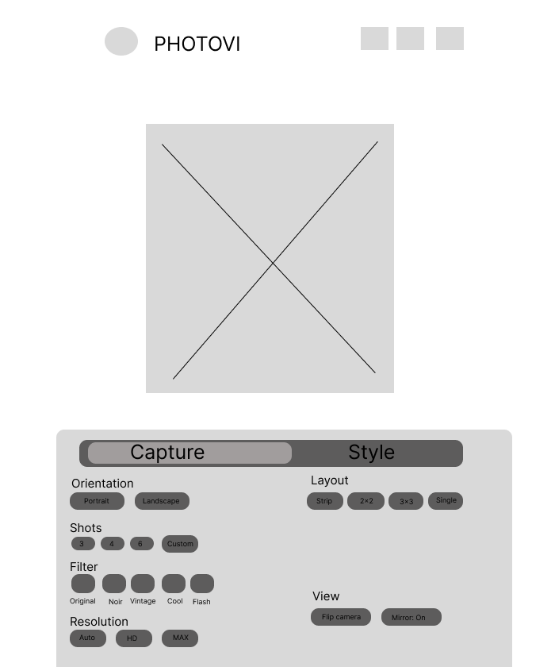
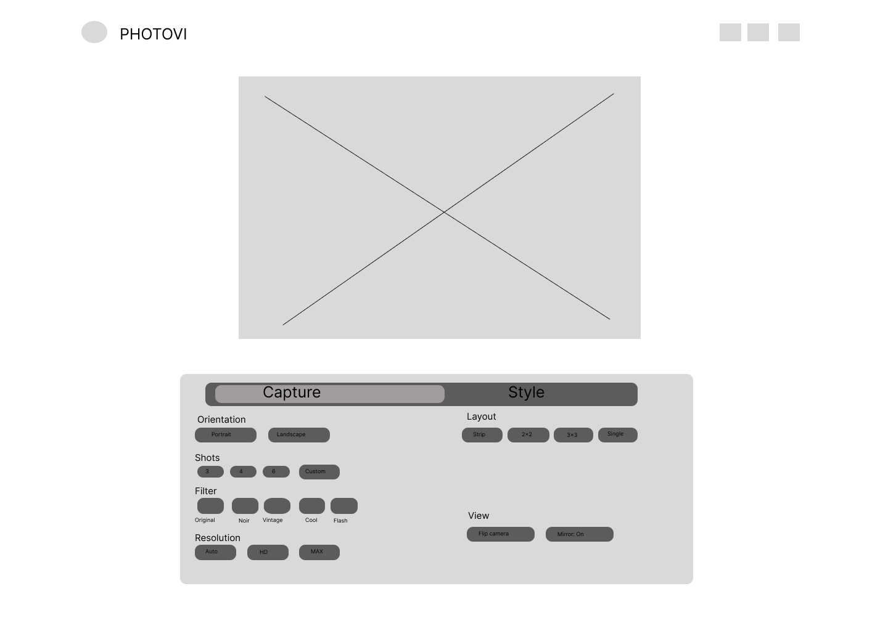

# PHOTOVI

## Project Framing and Design Brief

**Version 1.0**

**Subject:** Interactive Media Development

**Group:** Fantastic4

**Members:**
- Lawrence Brian Dejan
- Neoh Del Prado
- Juliamay Nina Estrada
- Kyle Tristan Turno

| Date | Version | Description | Author |
|------|---------|-------------|--------|
| 09/02//2026 | 1.0 | Project Framing and Design Brief | Fantastic4 |

---

## 1. Project Identity

| Field | Detail |
|-------|--------|
| Working project title | PHOTOVI (Digital Studio) |
| Prepared by | Lawrence Dejan, Neoh Del Prado, Juliamay Estrada, Kyle Turno (Fantastic4) |
| Submission date | 09-02-2026 |
| Project category / type | Browser-based interactive media experience digital photobooth studio |

**Concept statement:**

PHOTOVI digital studio is a browser based interactive experience that helps users and groups to capture a fun, styled photo-strip through a live camera preview, guided by a countdown and capture sequence and an instant downloadable keepsake without installing an application or creating an account.

---

## 2. Problem or Opportunity Statement

Getting a fun, styled photobooth style image is usually harder than it should be with all the editing and styling based on the user's preference. In most cases, people either need to look for a physical photobooth at a mall, party, or event, or hire someone to do all the styling which also costs a lot of money to alight with the customer's likeness. Neither options is something a small group or ourselves can do spontaneously in the middle of casual hangout or in a random afternoon.

This problem is most common among young people and students who gather informally at home or at celebrations nearby and setting up a new application in the middle of the gathering feels like a waste of time rather than immediately taking up the fun without any disruption. This situation matters because these small groups moments are often the ones who want a keepsake of the moment yet the available tools to capture are inconvenient, restrictive or simply overkill for one-time casual use.

An interactive browser-based experience is suited to this situation because it removes the biggest sources of disruption where the user need to install the app, encountering paywalled filters and effects that ruins the moment, PHOTOVI provides an experience while still being able to use live camera access, real time visual filters, timed interaction and audio feedback to recreate the fun of a real life photobooth. Since the entire experience can run in a browser, it fits naturally into a spontaneous, low effort moment between users and groups.

---

## 3. Intended Audience and Context

| Area | Information |
|------|-------------|
| Primary audience | Young adults and student groups roughly around ages 15–25 who want a fun, shareable group photo experience during casual social gatherings, such as house parties, dorm hangouts, or small celebrations. |
| User goal | Quickly capture a short, styled series of photos and walk away with one downloadable photo strip to keep or share, without needing a physical photobooth, a separate app, or an account. |
| Prior knowledge | Basic familiarity with using a web browser and tapping 'Allow' on a permission prompt. No technical knowledge or prior experience with photo-editing tools is expected. |
| Devices | Primarily smartphones held or propped up during use; also expected to work on tablets and laptops with a built-in or connected camera. |
| Access conditions | Typically used over home Wi-Fi or mobile data at a gathering. Since PHOTOVI does not upload or store anything on a server, it does not require a stable connection beyond loading the page itself. |
| Use environment | Casual, informal social settings: homes, dorm rooms, small parties, or similar gatherings, often with background noise and several people crowding around one device. |
| Accessibility considerations | Buttons and filter options must be labeled with text, not color alone, so they remain clear for users with color vision differences. Text needs enough contrast to read quickly in a busy, distracting environment. Sound cues (beep, shutter) should not be the only source of feedback, since the environment may be noisy or sound may need to be muted. |
| Privacy and ethics | Because PHOTOVI captures real photos of real people, it must clearly explain why camera access is needed, only request it with explicit user action, and make clear that no photo is uploaded or stored on a server — everything stays on the user's own device. |

---

## 4. Purpose and Desired Outcome

**Purpose:**

PHOTOVI helps casual users and groups to capture and keep a fun, styled. photo-strip quickly and easily digitally without needing a physical photobooth, separate application or a paid subscription.

**Desired Outcome:**

1. Users can preview how a filter will look on their photo before any picture is actually taken.
2. Users can complete an entire photo session, from granting camera access to downloading their strip, without creating an account or installing anything.
3. Users understand clearly why camera access is being requested and how to grant it, even if they accidentally deny it the first time.
4. Users receive clear visual and audio feedback (the countdown and shutter sound) at each step, so they always know what the system is doing and when the next photo will be taken.

---

## 5. Platform and Use Context

PHOTOVI will be a browser-based experience, built using HTML, CSS, and JavaScript, and it does not require installing an app or creating an account. The platform decisions below come directly from how and where the primary audience is expected to use it mainly on a single shared phone during a casual gathering.

1. **Screen sizes:** primarily mobile phone screens held in portrait orientation, since one phone is often shared or propped up during a session, with the layout also adapting to tablet and laptop screens.
2. **Mobile support:** required. Mobile is the most likely device used in the target setting, so the interface must work smoothly on a phone-sized screen first.
3. **Network conditions:** PHOTOVI performs all filtering, capturing, and compositing locally in the browser, so beyond loading the page itself, it does not depend on a stable connection or heavy data usage.
4. **Where and when it will be used:** informal social settings such as homes, dorms, or small gatherings, often in the evening, with background noise and multiple people nearby.
5. **Use of sound:** sound effects (the countdown beep and shutter sound) add to the fun, photobooth-like feeling, but the environment may sometimes be noisy or inappropriate for sound, so a mute option should reasonably be considered.
6. **Browser or device limitations:** PHOTOVI depends on browser support for camera access and it requires a secure (HTTPS) connection, since modern browsers only allow camera access on secure pages.

---

## 6. Initial Scope

The table below defines what will be designed, built, and tested for PHOTOVI within the semester, and what is deliberately being out of the team's scope.

| In Scope | Out of Scope |
|----------|--------------|
| Live camera preview streamed to the browser | User accounts, login, or saved profiles |
| Real-time filter preview before capturing | Persistent history or gallery of past sessions |
| Selecting a shot count (e.g. 3 or 4 photos) | Advanced photo editing tools |
| Visible countdown with an audio beep before each photo | Direct social media sharing or posting integrations |
| Automatic multi-photo capture with a shutter sound | Multi-device or networked photobooth sessions |
| Compositing captured photos into one styled strip with spacing, borders, and a date-stamp spot | Physical printing or hardware integration |
| One-click download of the finished strip as a single image | Cloud storage or server-side saving of any photo |
| Friendly handling of denied camera access or failed filters | Support for older browsers that lack camera/canvas/audio APIs |

The main user task is a single, self-contained session: open PHOTOVI, preview and pick a filter, choose a shot count, go through the guided capture, and download the finished strip. The experience is expected to cover a small number of screens, live preview, capture, countdown, and results, and a handful of filters, and no persistent data beyond the single session.

---

## 7. Assumptions, Constraints and Risks

### Assumptions

1. Users have a device with a working, unobstructed camera and a reasonably up-to-date browser (Chrome, Edge, Firefox, or Safari).
2. Users are in a space with enough light for the camera to capture a clear, recognizable image.

### Constraints

1. The system must be built using only HTML, CSS, and JavaScript, with no backend server or database, per the course requirements for this activity.
2. Development must fit within one semester alongside other coursework, which limits how many filters, animations, or extra polish features can realistically be completed and tested.

### Risks

1. A user may deny camera access, which blocks the core experience entirely. Show a clear, friendly message explaining why camera access is needed, along with simple steps to enable it if the user changes their mind.
2. Some browsers or older devices may not fully support the Canvas API or Web Audio API, causing filters or sound effects to fail.
3. Poor lighting or a low-quality camera could result in a strip the user is unhappy with, reducing how enjoyable the experience feels. Keep the live filtered preview visible at all times before capture, so users can reposition themselves or adjust their environment before starting the countdown.

---

## 8. Initial Success Criteria

1. A user can complete a full photo session, granting camera access, choosing a filter, selecting a shot count, capturing all photos, and downloading the strip without seeking any help..
2. The live filter preview updates with minimal delay, so it still feels like a real-time camera feed rather than a slow effect.
3. The finished photo strip downloads successfully as a single image file on both a mobile browser and a desktop browser.
4. The interface remains usable at mobile viewports, without cut-off buttons or overlapping text.
5. Users receive clear visual and audio feedback countdown and shutter sound before and during each photo capture.
6. If camera access is denied or a filter fails to load, PHOTOVI shows a clear message instead of freezing, crashing, or showing a blank screen.
7. No photo, video, or personal data is transmitted to or stored on an external server at any point during the session.
8. The main page and live camera preview load within a few seconds on a typical home internet or mobile data connection.

---

## 9. Initial Concept Direction

Three rough layout directions were sketched to explore how the capture flow and results screen could be arranged. These are early, exploratory sketches meant to test different structures, not finished designs.

### Concept A - Mobile Vertical Flow

### Concept B - Desktop / Tablet / Laptop Layout

**Rationale:**

Concept A currently appears strongest, since it is built mobile-first and matches how the primary audience is expected to actually use PHOTOVI on a single phone, held or propped up during a casual gathering. Its simple top-to-bottom flow like preview, filter, settings, countdown and results keeps each step obvious without requiring instructions, which directly supports the goal of a fast, no hassle photo session.

Concept B is being kept as a secondary direction for larger screens, since PHOTOVI should still function reasonably well on a tablet, desktop or laptop even if that is not the primary use case.

Open questions that still need to be investigated include: how many filters can realistically be built and tested well within the semester, how the countdown overlay should look so it doesn't block too much of the live preview, and whether a mute toggle for sound effects should be part of the initial scope or a later addition.

---

## 10. Sources and Attribution

The following sources and references informed the framing of this project:

- PHOTOVI Project Proposal (Part of this same Interactive Media activity, developed with team Fantastic4).
- Class Resources folder- SRS and project planning templates/examples provided by the instructor.
- Comparable experience referenced for general inspiration: physical, coin-operated photobooth machines commonly found at malls and events (general public knowledge, not a specific cited source).

**Generative AI disclosure:**

Generative AI was used to help revise sentence structure, grammar, and clarity in this document. The project decisions, audience details, scope, risks, and criteria are the team's ideas, based on the team's PHOTOVI proposal and SRS; AI was used only to help polish the wording in creating some of the content.
